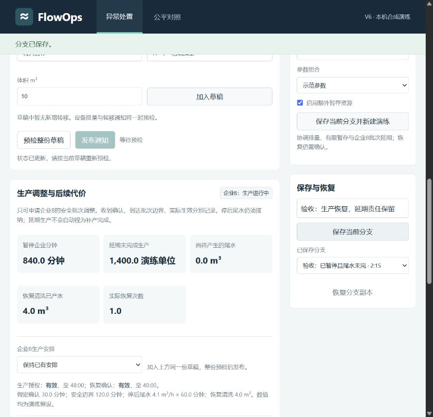
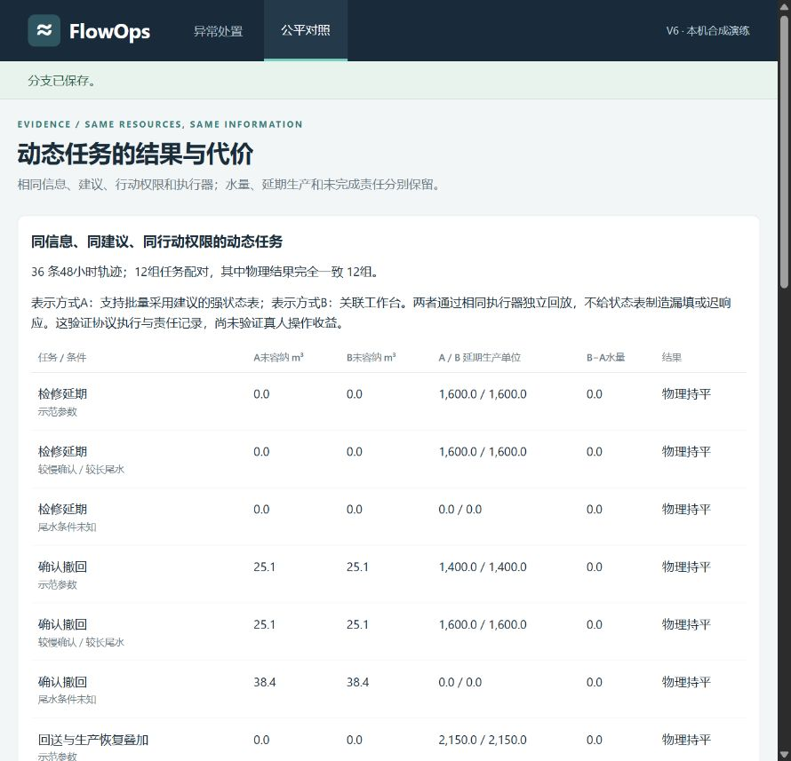

# FlowOps Engineering

**A reproducible wastewater incident-coordination prototype with explicit execution constraints, recovery obligations, and negative results.**

FlowOps explores how a coordinator can revise enterprise discharge, temporary storage, and a production-deferral request when receiving capacity changes. It tracks the difference between a notification, an acknowledgement, and an actual equipment or production change. Wastewater already generated, residual production water, restart cleaning water, and unfinished manufacturing remain visible.

This repository is an **engineering portfolio artifact**. Its four incident tasks use declared synthetic parameters. It has no field deployment, calibrated treatment model, or measured user-adoption result.



## Run locally

Python 3.11+ is intended; the publication copy was tested on Python 3.14. Python runtime and tests use only the standard library. Node.js 18+ is needed only for the UI-model tests.

```bash
python -B -m xylem.wastewater_workbench_v6.server --port 8781
```

Open <http://127.0.0.1:8781/>. The server binds to loopback. It creates a local `runtime/current.json`; no personal session is distributed.

```bash
python -B -m unittest discover -s xylem/wastewater_workbench_v6/tests -p "test_*.py" -q
node --test xylem/wastewater_workbench_v6/tests/ui.cjs
python -B verify_release.py
```

The publication copy passes **45 Python tests** and **9 Node tests**. CI rechecks the copied release independently. See [architecture](docs/ARCHITECTURE.md), [results](docs/RESULTS.md), and [limits](docs/LIMITATIONS.md).

## Engineering mechanisms

- Atomic publication of mixed discharge, transfer, and production requests after an exact-draft preflight.
- Owner-confirmation revisions, expiry, cancellation, and delayed execution at declared batch boundaries. Renewed permission does not revive a previously invalidated order.
- Explicit actuator capabilities, restart prerequisites, notification budgets, and temporary-storage return obligations.
- Persistent sessions with atomic replace, revision checks, saved branches, and public-only forecast reconstruction.
- Conservation accounting for existing water, residual tail, transit, restart water, and outstanding manufacturing.
- A conditional four-hour cost preview that separates production interruption from water volume.

Development was AI-assisted. The repository emphasizes inspectable mechanisms, executed checks, and bounded conclusions rather than attributing unverified industry benefit to the software.

## What the experiment found

Four tasks × three profiles × three branches produce **36 saved 48-hour trajectories**. Twelve matched comparisons use the same observations, advice, action rights, and physical executor:

| Comparison | Result | Interpretation |
| --- | --- | --- |
| Competent status table vs linked workbench | 12/12 full physical ties | Transaction parity; no measured human or algorithm advantage |
| Shared advice vs deliberately maintaining production | 6 lower uncontained-water totals, 6 ties | Action diagnostic; lower output is a cost, not water saved |
| Manufacturing debt under deferral | Increased in 8 configurations | Reported separately from water outcomes |
| Maintenance task, base and slow profiles | +960 enterprise-minutes paused and +1600 synthetic units unmet; no final uncontained improvement | Retained counterexample to the advice policy |

All adverse records remain published. There were **zero external participants**; user time savings, fewer mistakes, adoption, pollution reduction, and economic benefit are unmeasured.



## Reproduce the evidence

The complete current run is under [`v6_r2`](xylem/wastewater_workbench_v6/artifacts/comparison/v6_r2). It includes the protocol frozen before execution, source snapshot, 36 gzip traces, results, and run audit. The earlier r1 protocol, results, audit, and source snapshot are retained as provenance; its full traces remain in the preserved local archive rather than duplicated here.

```bash
# Existing frozen directories are never overwritten. Choose a NEW output path.
python -B -m xylem.wastewater_workbench_v6.comparison --output xylem/wastewater_workbench_v6/artifacts/comparison/my_run
python -B -m xylem.wastewater_workbench_v6.build_task_pack
```

The matrix takes several minutes. The second command derives task materials from the current saved results; it does not create participant evidence. `verify_release.py` checks the distributed evidence without rerunning the matrix.

Historical `v3` and `v5` Python modules and the original synthetic protocol are included to preserve the exact dependency paths used by the frozen v6 computation. They are compatibility sources, not separate supported applications in this release.

## Public-document transfer check

A separate public engineering document supports a concrete coordination requirement: an enterprise unable to stop immediately must report subsequent wastewater and maintain coordination with the park's wastewater facility. It also describes returning stored wastewater for re-treatment. [The transfer check](docs/PUBLIC_TASK.md) records why this **does not establish a successful real-site integration**: current flow, available storage, residual water, authority, and manufacturing costs are missing; the treatment route differs from the prototype's simplified transfer model.

## 中文概览

本项目作为工程能力展示保存：重点是带约束的通知执行、状态持久化、恢复责任、水量守恒及公平对照。实验保留了持平与退步结果，没有证明工作台优于好状态表，也没有把少生产产生的水量下降称为节水。公开案例核查发现了实际输入与工艺映射缺口，因此暂停继续扩充功能。

Third-party engineering documents are linked, not redistributed. See [source references](docs/PUBLIC_TASK.md). Code publication does not imply endorsement by a utility, government agency, Xylem, or a competition organizer.
