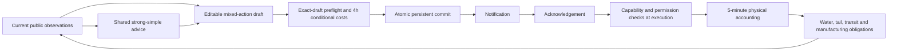

# Architecture

The Python simulation advances in five-minute physical substeps and exposes fifteen-minute observations. Rate, transfer, and production actions have distinct admission and execution stages. A current permission check cannot erase an earlier revocation: pending affected production orders become terminally rejected, and renewal requires a new request.

`service.py` persists a successful cloned transaction using a temporary file, `fsync`, and atomic replace. API revisions and the exact bundle bind preflight to the draft. Forecast reconstruction keeps allowlisted public state and strips private future disturbances.

`production.py` accounts for safe-boundary delays, residual water, minimum pause, restart prerequisites and one-time cleaning water. Deferred production stays outstanding; the model has no catch-up production promise. `disposition.py` maintains stored and in-transit volumes and the duty to return temporary storage.

`tasks.py` gives the competent table adapter and workbench adapter the same advice and rights. Both use the same physical executor. Their scripted equality is intentional and cannot measure human usability. A separate maintain-production branch is an action diagnostic.

The UI is vanilla JavaScript/CSS. The local server uses Python's standard library. There are no cloud credentials, external AI APIs, device-control connections, or live industrial identities.
